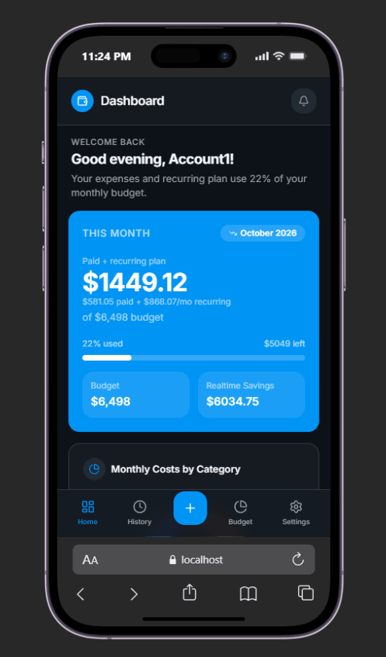
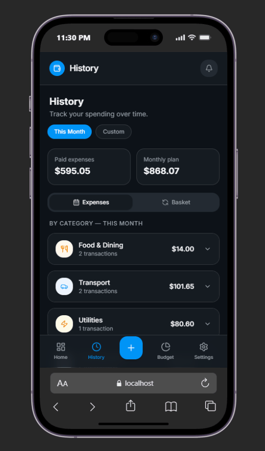
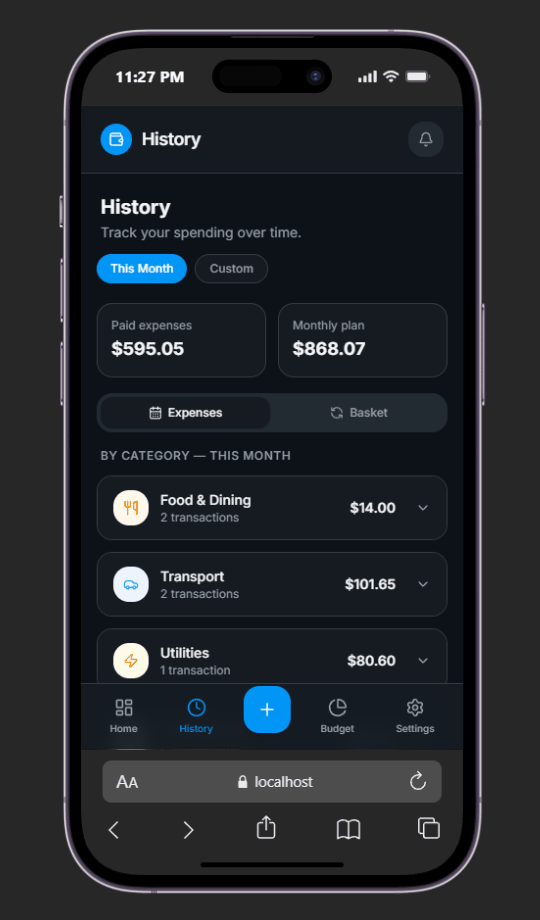
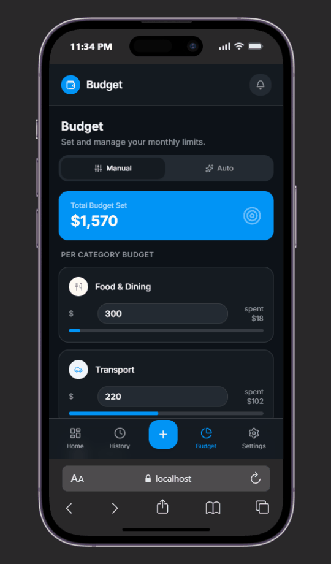
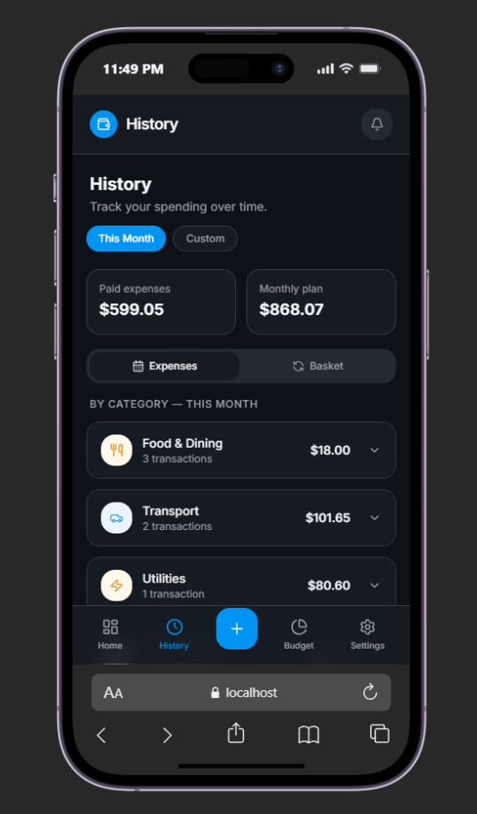
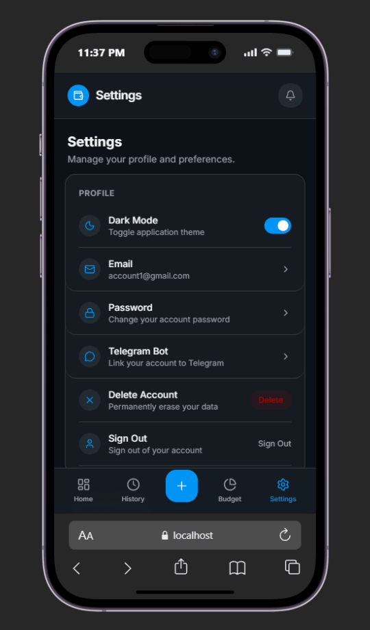
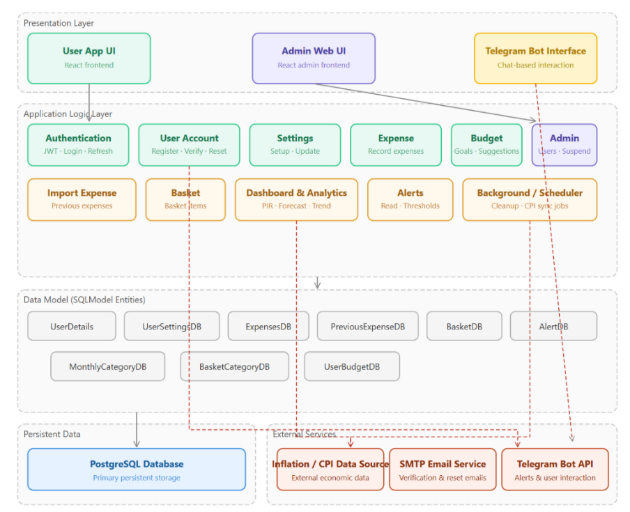

# SpendWise

SpendWise is a personal finance app for tracking expenses, managing budgets, and seeing how price changes affect your spending. This repository contains the web app, an optional Telegram bot, and the SC2006 project diagrams and demo media.

## App walkthroughs

These six clips show the main app flows using demo data. Select a clip to open its full-size GIF.
<table>
  <tr>
    <td align="center"> <strong>Dashboard</strong> Review spending summaries and charts.</td>
    <td align="center"> <strong>Add an expense</strong> Record a transaction from the history screen.</td>
    <td align="center"> <strong>Transaction history</strong> Browse and filter recorded expenses.</td>
  </tr>
  <tr>
    <td align="center"> <strong>Budgets</strong> Review budget categories and spending.</td>
    <td align="center"> <strong>Spending alerts</strong> See an alert appear after spending crosses a threshold.</td>
    <td align="center"> <strong>Settings</strong> Manage preferences and account options.</td>
  </tr>
</table>

## What it does

- Manage an account, expenses, categories, and monthly budgets.
- Review spending summaries, trends, and alerts.
- Compare personal spending changes with Consumer Price Index data.
- Optionally connect a Telegram bot to selected app workflows.

## Architecture

The web client is built with React and Vite. A FastAPI backend serves the app and connects to PostgreSQL. Scheduled backend tasks fetch CPI data; the optional Telegram bot runs as a separate Python process.

See the [diagram index](Diagrams/README.md) for the use case, class, and user-flow diagrams.

## Run the app

The detailed guide covers prerequisites, environment configuration, database migrations, local demo accounts, and commands to run each component:

**[SpendWise setup and run guide](../README.md)**

In brief, the app needs Python, Node.js/npm, and PostgreSQL. The Telegram bot is optional. Keep local `.env` credentials private.
