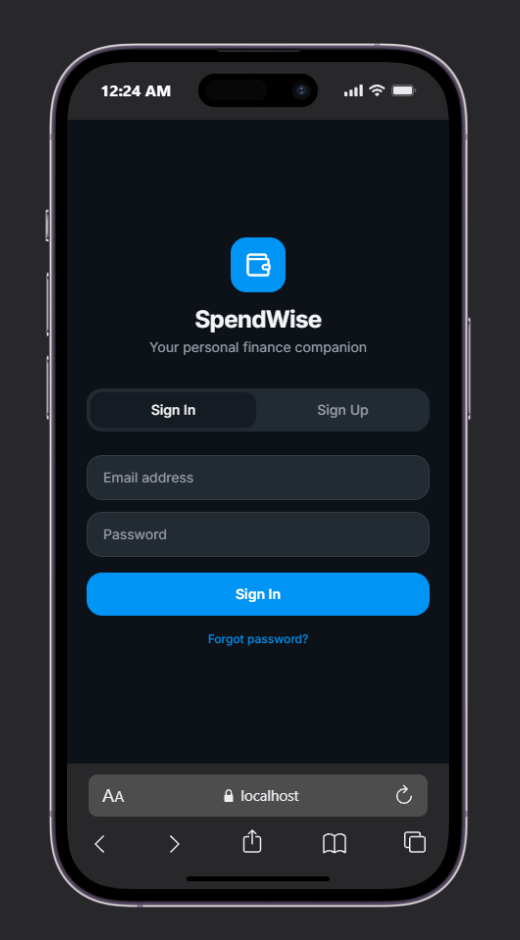

# SpendWise SC2006 NTU Group Project

SpendWise is a personal-finance application for tracking expenses and budgets while exploring how inflation affects a person's spending. It is a course project built as a web app with an optional Telegram bot.

<p align="center">
  <br>
  <strong>A Quick Look</strong>
</p>

## Features

- Account registration, authentication, settings, and email verification flows
- Expense and category management, imports, and dashboard summaries
- Budget settings, suggestions, and spending alerts
- Personal inflation analysis using CPI data and scheduled backend tasks
- Optional Telegram bot workflows connected to the backend

Feature availability depends on the local database and configured integrations.

See the [app walkthroughs](./Misc/walkthroughs.md#app-walkthroughs) for short GIF demos.

## Architecture

- **Frontend:** React and Vite, with Tailwind CSS. The Vite development server proxies API requests to FastAPI on `127.0.0.1:8000`.
- **Backend:** FastAPI and SQLModel, backed by PostgreSQL through psycopg.
- **Background work:** APScheduler tasks and CPI data fetching run in the backend process.
- **Bot:** A separate Python Telegram bot calls the backend API.


Additional submission diagrams are in [`Misc/Diagrams/`](Misc/Diagrams/).

## Requirements

- Python 3.13 or later
- Node.js and npm
- A local PostgreSQL server and database

The Python requirements are listed in `requirements.txt`; frontend dependencies are locked in `SpendWise_frontend/package-lock.json`.

## Local setup

Run these commands in PowerShell from the `SC2006 Shared project` directory.

1. Create and activate a Python virtual environment, then install the backend dependencies:

   ```powershell
   py -3.13 -m venv .venv
   .\.venv\Scripts\Activate.ps1
   python -m pip install -r requirements.txt
   ```

2. Create a local `.env` from the safe template only if one does not already exist:

   ```powershell
   if (-not (Test-Path .env)) { Copy-Item .env.example .env }
   ```

   Configure PostgreSQL and replace the placeholders in `.env`. The current settings model requires the database, authentication, email, backend URL, Gemini, Telegram, and internal bot variables; `SENDER_NAME` has a default. Both the backend and bot load this file from the project directory regardless of the launch directory. Keep real credentials in `.env`; do not commit them. SQL statement echo is off by default. Set `DB_ECHO=true` only when debugging locally; parameter values remain hidden.

3. Create a PostgreSQL database and user, then set `DB_HOST`, `DB_PORT`, `DB_NAME`, `DB_USERNAME`, and `DB_PASSWORD` in `.env`. For an existing database, run `alembic upgrade head` from this directory before starting the backend. The current revision adds failed-code counters and clears any outstanding plaintext verification/reset codes; users can request new codes afterward. Backend startup creates missing tables with SQLModel, but does not update existing tables.

4. Install frontend dependencies from the lockfile:

   ```powershell
   Set-Location .\SpendWise_frontend
   npm ci
   Set-Location ..
   ```

## Run locally

Start the backend in one terminal from the project directory:

```powershell
fastapi dev .\SpendWise_App\main.py
```

Start the frontend in another terminal:

```powershell
Set-Location .\SpendWise_frontend
npm run dev
```

Open <http://localhost:5173>. The Telegram bot is optional; start it in a third terminal only when its token and backend settings are configured:

```powershell
python .\Telegram_bot\bot_main.py
```

`start_all.bat` launches the backend, frontend, and bot together in separate Windows terminals. The bot is not required for the web app.

`stop_all.bat` also terminates any process listening on ports 5173 and 8000. Check that those ports belong to SpendWise before running it if other local services may be using them.

## Local demo accounts

Normal backend startup does **not** create demo accounts. To seed the standard demo accounts intentionally, run this from the project directory against a disposable local database:

```powershell
python -m SpendWise_App.demo
```

The command asks for confirmation and prompts for a password of at least 12 characters. It applies that password to newly created demo accounts and leaves accounts that already exist unchanged. If your database was used with the previous automatic seeding, review any existing demo accounts separately. Use a temporary password and do not use this command against a production database.

## Frontend checks

Run from `SpendWise_frontend`:

```powershell
npm run lint
npm run build
```


